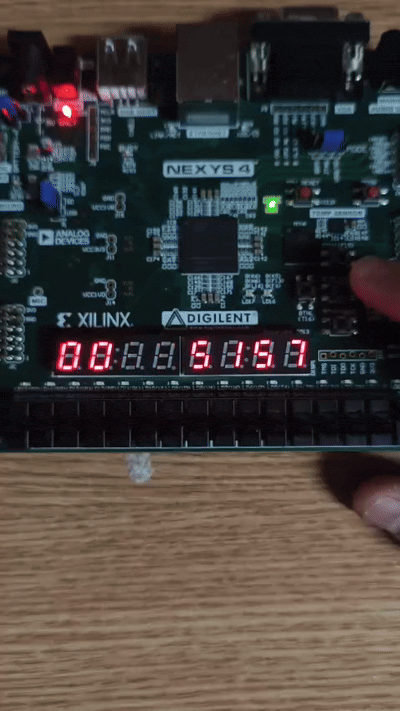
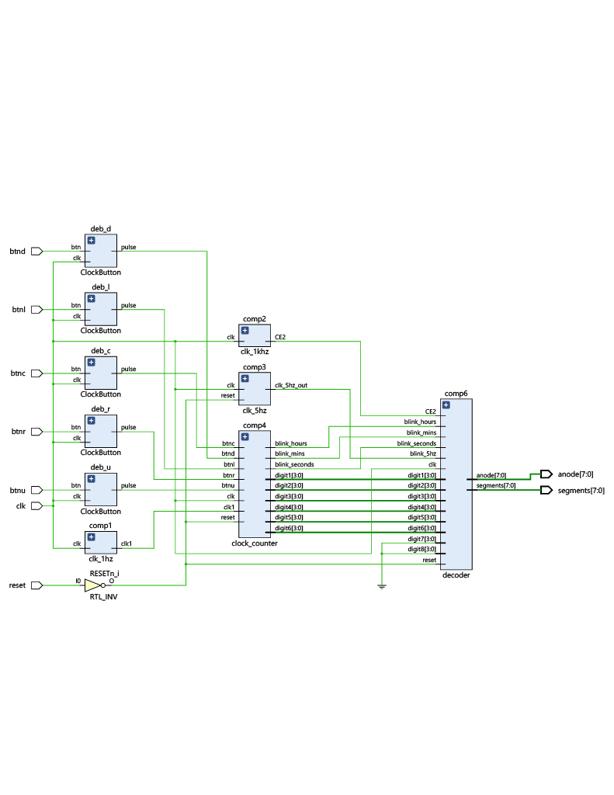
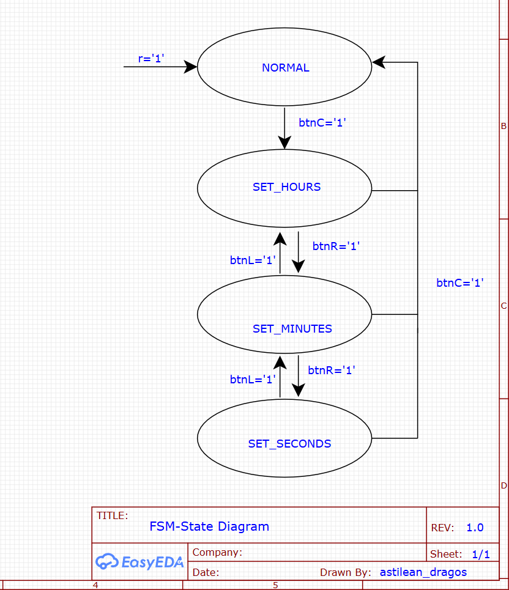
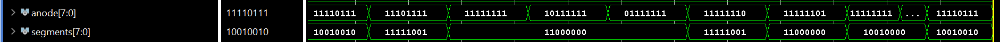
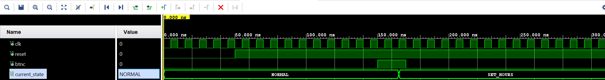

# FPGA 24-Hour Digital Clock

A complete 24-hour digital clock hardware implementation on the Digilent Nexys 4 FPGA board. The project features real-time tracking, a state-machine-based time-setting interface, and dynamic display multiplexing.

## Hardware Demo
*Live demonstration of the digital clock running on the Nexys 4 board, showing the time-setting functionality and blinking effects.*  

## Tech Stack
- **Language:** VHDL
- **Hardware:** Digilent Nexys 4 (Artix-7)
- **Tools:** Xilinx Vivado

## Hardware Architecture
The system is highly modular, separating the clock dividers, the main counter logic, and the 7-segment display drivers.

### RTL Schematic
Block diagram showing the interconnection between the debouncers, clock dividers, main counter, and decoder modules:  

### FSM State Diagram
The Finite State Machine controlling the time-setting interface (Hours, Minutes, Seconds) triggered by the hardware buttons:  

## Simulation & Verification
The design behavior was functionally verified using Vivado Simulator with custom testbenches.

**1. Display Multiplexing**  
Verified the 1kHz refresh rate, ensuring proper anode scanning (`11111110`, `11111101`, etc.) and BCD-to-7-segment conversion.  

**2. FSM Transitions**  
Validated the state machine transitions (e.g., `NORMAL` to `SET_HOURS` upon pressing the center button) and the hardware debouncing logic:  

## How to Run
1. Open a new RTL project in Xilinx Vivado.
2. Import all the `.vhd` source files and the Nexys 4 `.xdc` constraint file.
3. Set `main_file.vhd` as the Top Module.
4. Run Synthesis, Implementation, and Generate Bitstream.
5. Program the FPGA board.

## AI Usage
Artificial Intelligence tools were utilized during the development of this project to enhance workflow efficiency:
- **Testbench Generation:** Assisted in writing boilerplate code and structuring timing events for the VHDL simulations.
- **Debugging:** Used to identify syntax errors, troubleshoot FSM logic transitions, and resolve debouncer timing issues.
- **Documentation:** Helped format and structure the project documentation for better readability and presentation.
